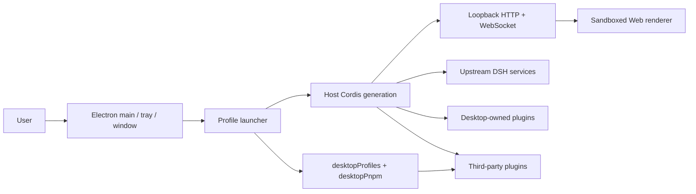

# DSH Desktop Architecture

## Overview

DSH Desktop is a thin Electron host. It starts the official DSH Host in Electron's main process; the Host exposes the ordinary Web UI over loopback HTTP/WebSocket. Desktop does not create a second renderer IPC plugin system and does not expose raw Electron APIs to the page.

## Startup order

1. Electron acquires the single-instance lock and reads Desktop-owned profile/mode state.
2. The launcher prepares the active profile without modifying profiles merely to list them.
3. The launcher provides the native runtime, the generation's `desktopProfiles` bootstrap, and the bundled pnpm environment.
4. The Host Cordis root mounts Loader entries. Desktop services are registered before third-party entries can consume them.
5. `dsh-base`, `dsh-web-app`, and the selected profile's third-party bundles compose the Web carrier.
6. The Host binds a loopback port; Electron creates the BrowserWindow and loads the same-origin page.
7. The tray is created only after the Web surface loads, and the profile is committed as last-known-good.

Every profile or mode switch disposes the current generation before starting the next one. Service references, window objects, and subprocess handles must not be cached across generations.

## Host, Client, and native runtime

- **Upstream Host** owns agent, model, tool, session, settings, webServer, and subprocess capabilities.
- **Desktop Host** owns the window, tray, profiles, terminal, updates, and the two public Desktop services.
- **Web Client** contains the official Web UI and third-party browser contributions. It works over the loopback carrier and does not call Electron directly.
- **Native runtime** adapts Electron BrowserWindow, the tray, filesystem/network operations, and installers. `desktopRuntime` is for Desktop-owned rows only.

The everyday `desktop` experience is resolved independently from `system`/`native` window appearance. Host routes, Add controls, image actions and the voice window are shared; only native appearance replaces root/layout geometry. Agent presets do not select desktop features. Legacy mode values remain migration and window-adapter inputs.

`upstream-diagnostic` is a transient restart argument. The launcher disables third-party rows in the in-memory composition and restores the official layout. The Desktop client runs only its Sidebar-independent boot reporter. Diagnostics do not consume pending Profile selections, claim installation WALs, or commit normal preferences, health promotion or failure rollback. Returning to the everyday desktop restores the normal composition.

Profile appearance uses a fixed `presentation-v2.json` record and retains a strict v1 `state.json` mirror readable by older executables. The v2 digest identifies that mirror. An interruption between atomic writes, or an older executable updating v1, is recovered by migrating the complete v1 values again. These records contain no model, credential or session copies.

### Native shell generation and platform adapters

`ElectronRuntime` coordinates the Host and native desktop environment without directly owning window and tray details. Each start creates one `ElectronShellGeneration` module that completely owns its `BrowserWindow`, `Tray`, related Electron listeners, navigation restrictions, external-link handling, and zoom shortcuts. A generation must be disposed through its idempotent `release()` interface; callers must not cache or destroy those resources separately across generations.

Platform differences live at the `ElectronPlatformStrategy` seam selected once during startup. The Windows, macOS, and Linux adapters declare directory-picking, shell-mode, and update-download capabilities and own their platform-specific menu, Dock icon, and native-material operations. New platform branches belong in the corresponding adapter; the generation and runtime retain only the lifecycle shared across platforms.

## Profile and service boundaries

The profile name and absolute directory come from `desktopProfiles.current`; they must not be inferred from argv, settings, or a URL. `list()` is read-only discovery. `select()` records a pending target and completes the switch through restart.

`desktopPnpm.run()` runs bundled pnpm directly. `runPlugin()` uses packaged DSH CLI semantics so profile initialization, relative sources, and bundle reconciliation remain authoritative. Both operations belong to the current generation and use the subprocess service for complete process-tree ownership.

The launcher-private `desktopRuntime`, `desktopPnpmBootstrap`, Electron executable, Node helpers, and ABI environment are not third-party APIs. The supported public contracts are only `dsh-plugin-desktop/profile-service` and `dsh-plugin-desktop/pnpm`.

## Packaging and runtime closure

Release artifacts use Electron Builder and `app.asar`. The reviewed physical-runtime policy places required resources such as pnpm, node-pty, and Windows ACL/native files under `app.asar.unpacked`. The packaged-runtime gate checks archive entries and physical files. Host and Client resolution follows the current installation and actual Profile package ownership; the official in-memory generation bypasses historical shared projections. Desktop no longer writes dependency links into shared `profiles/node_modules`. Third-party plugins retain local resolution for their private dependencies.

The outer workspace uses Yarn. The pinned `deepseek-harness/` submodule keeps its own pnpm workspace. Desktop source, tests, packaging, and release scripts belong to `dsh-plugin-desktop/`; the upstream submodule is not edited from Desktop branches.

## Maintainer reading

- [Desktop service contract](../dsh-plugin-desktop/docs/plugin-services.md)
- [Package README](../dsh-plugin-desktop/README.md)
- [Pinned upstream and isolated Yarn workspace](../.agents/notes/implemented/process/2026-08-15-pinned-upstream-and-isolated-yarn-workspace.md)
- [Profile and pnpm services decision](../.agents/notes/implemented/architecture/2026-08-15-desktop-profile-and-pnpm-services.md)
- [Advanced shell decision](../.agents/notes/implemented/architecture/2026-08-15-desktop-advanced-shell.md)
- [Native shell generation and platform adapters](../.agents/notes/implemented/architecture/2026-08-19-native-shell-generation-and-platform-adapters.md)
